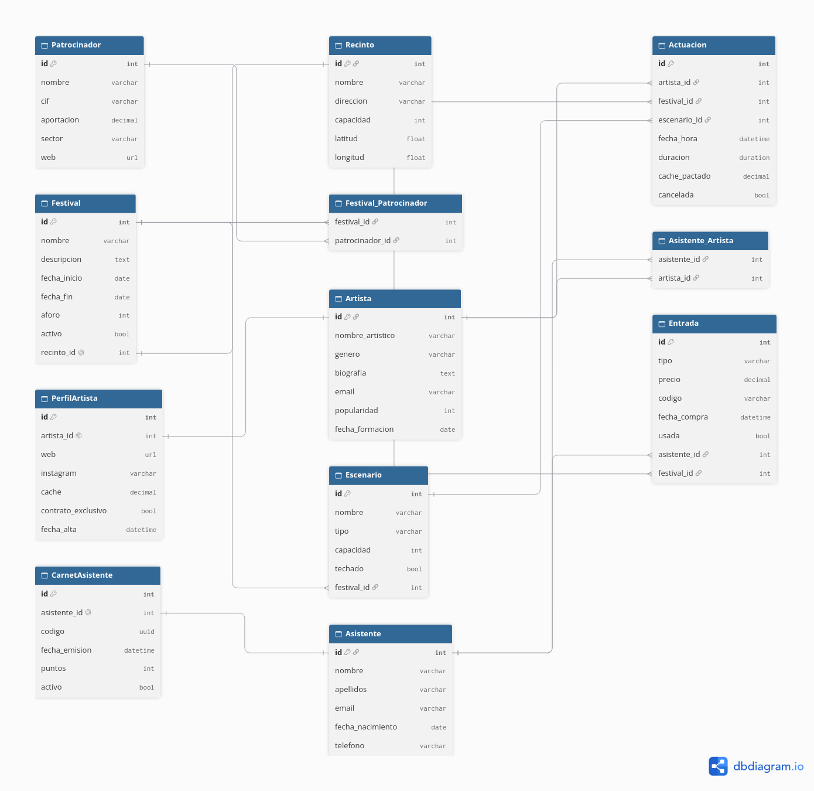

# Festivales Django

Plataforma web para la **gestión de festivales de música**. Permite administrar festivales, recintos, artistas, escenarios, actuaciones, patrocinadores, asistentes, carnets y entradas.

## Índice

1. [Instalación y puesta en marcha](#1-instalación-y-puesta-en-marcha)
2. [Estructura de ramas de Git](#2-estructura-de-ramas-de-git)
3. [Archivos que no se suben a Git](#3-archivos-que-no-se-suben-a-git)
4. [Modelos, atributos y parámetros](#4-modelos-atributos-y-parámetros)
5. [Relaciones entre modelos](#5-relaciones-entre-modelos)
6. [Tipos de campo usados](#6-tipos-de-campo-usados)
7. [Parámetros usados](#7-parámetros-usados)
8. [Esquema entidad-relación](#8-esquema-entidad-relación)
9. [Seeders](#9-seeders)
10. [Comando con Faker](#10-comando-con-faker)
11. [Backup con fixture](#11-backup-con-fixture)
12. [Código no visto en clase](#12-código-no-visto-en-clase)

---

## 1. Instalación y puesta en marcha

```bash
git clone <URL-del-repositorio>
cd festivales-django
python3 -m venv venv
source venv/bin/activate
pip install -r requirements.txt
python3 manage.py migrate
python3 manage.py seeders
python3 manage.py runserver
```

- `python3 -m venv venv`: crea un entorno virtual aislado para las librerías del proyecto.
- `source venv/bin/activate`: activa ese entorno.
- `pip install -r requirements.txt`: instala las dependencias guardadas con sus versiones.
- `pip freeze > requirements.txt`: guarda las dependencias instaladas (se usó para generar el archivo).
- `django-admin startproject festivales .`: crea el proyecto en la carpeta actual. El punto final evita una carpeta duplicada `festivales/festivales/`.
- `python3 manage.py startapp gestion`: crea la aplicación `gestion`, donde están los modelos.
- `python3 manage.py makemigrations`: genera los archivos de migración con las instrucciones para crear o modificar las tablas.
- `python3 manage.py migrate`: ejecuta las migraciones sobre la base de datos (`db.sqlite3`).
- `python3 manage.py check`: revisa el proyecto y avisa de errores sin ejecutarlo.
- `python3 manage.py runserver`: arranca el servidor de desarrollo en `http://127.0.0.1:8000/`.

La aplicación `gestion` está registrada en `INSTALLED_APPS` dentro de `festivales/settings.py`.

---

## 2. Estructura de ramas de Git

| Rama | Contenido |
|---|---|
| `main` | Rama principal. Contiene el `.gitignore` inicial. |
| `Configuracion_inicial` | Proyecto Django, entorno y `requirements.txt`. |
| `Modelos` | Modelos, migraciones, esquema E-R, seeders y comando Faker. |
| `Backups` | Copia de seguridad de los datos (fixture). |

---

## 3. Archivos que no se suben a Git

Se excluyen con `.gitignore`:

| Entrada | Motivo |
|---|---|
| `venv/`, `.venv/`, `env/` | El entorno virtual pesa mucho y se recrea con `requirements.txt`. |
| `__pycache__/`, `*.pyc`, `*.pyo` | Archivos compilados que genera Python solos. |
| `db.sqlite3` | Base de datos local, que cada uno genera con `migrate`. |
| `.env` | Variables de entorno y datos sensibles. |
| `.idea/`, `.vscode/` | Configuración personal del editor. |
| `.DS_Store`, `Thumbs.db` | Archivos basura del sistema operativo. |

La carpeta `gestion/migrations/` **sí** se sube, porque define la estructura de la base de datos.

---

## 4. Modelos, atributos y parámetros

El proyecto tiene **10 modelos**, definidos en `gestion/models.py`. En cada tabla, la columna *Parámetros* indica qué opciones se han usado en el campo.

### 4.1 Recinto

Lugar físico donde se celebra un festival.

| Atributo | Tipo | Parámetros | Descripción |
|---|---|---|---|
| `nombre` | CharField | `max_length=100`, `unique=True`, `verbose_name` | Nombre del recinto, sin repetirse. |
| `direccion` | CharField | `max_length=200` | Dirección postal. |
| `capacidad` | PositiveIntegerField | `validators=[MinValueValidator(1)]`, `help_text` | Número máximo de personas. |
| `latitud` | FloatField | `null=True`, `blank=True` | Coordenada geográfica opcional. |
| `longitud` | FloatField | `null=True`, `blank=True` | Coordenada geográfica opcional. |

### 4.2 Patrocinador

Empresa que financia festivales.

| Atributo | Tipo | Parámetros | Descripción |
|---|---|---|---|
| `nombre` | CharField | `max_length=100` | Nombre de la empresa. |
| `cif` | CharField | `max_length=9`, `unique=True` | Identificación fiscal única. |
| `aportacion` | DecimalField | `max_digits=10`, `decimal_places=2`, `default=0` | Dinero aportado. |
| `sector` | CharField | `max_length=50`, `blank=True` | Sector de la empresa. |
| `web` | URLField | `blank=True` | Página web. |

### 4.3 Festival

Evento principal del proyecto.

| Atributo | Tipo | Parámetros | Descripción |
|---|---|---|---|
| `nombre` | CharField | `max_length=100` | Nombre del festival. |
| `descripcion` | TextField | `blank=True` | Texto largo descriptivo. |
| `fecha_inicio` | DateField | — | Primer día. |
| `fecha_fin` | DateField | — | Último día. |
| `aforo` | PositiveIntegerField | `default=1000` | Aforo total. |
| `activo` | BooleanField | `default=True` | Si el festival está vigente. |
| `recinto` | OneToOneField | `on_delete=CASCADE`, `related_name="festival"` | Recinto donde se celebra. |
| `patrocinadores` | ManyToManyField | `related_name="festivales"`, `blank=True` | Empresas que lo patrocinan. |

### 4.4 Artista

Músico o grupo que actúa en los festivales.

| Atributo | Tipo | Parámetros | Descripción |
|---|---|---|---|
| `nombre_artistico` | CharField | `max_length=100`, `unique=True` | Nombre artístico único. |
| `genero` | CharField | `max_length=20`, `choices=GENEROS`, `default="otro"` | Género musical (rock, pop, electrónica, hip hop, flamenco, otro). |
| `biografia` | TextField | `blank=True` | Biografía. |
| `email` | EmailField | `blank=True` | Correo de contacto. |
| `popularidad` | PositiveIntegerField | `default=0`, `validators=[MinValueValidator(0)]` | Puntuación de popularidad. |
| `fecha_formacion` | DateField | `null=True`, `blank=True` | Fecha de formación del artista o grupo. |
| `festivales` | ManyToManyField | `through="Actuacion"`, `related_name="artistas"` | Festivales en los que actúa. |

### 4.5 PerfilArtista

Datos profesionales ampliados de cada artista.

| Atributo | Tipo | Parámetros | Descripción |
|---|---|---|---|
| `artista` | OneToOneField | `on_delete=CASCADE`, `related_name="perfil"` | Artista al que pertenece. |
| `web` | URLField | `blank=True` | Web oficial. |
| `instagram` | CharField | `max_length=50`, `blank=True` | Usuario de Instagram. |
| `cache` | DecimalField | `max_digits=10`, `decimal_places=2`, `default=0` | Caché habitual. |
| `contrato_exclusivo` | BooleanField | `default=False` | Si tiene contrato de exclusividad. |
| `fecha_alta` | DateTimeField | `auto_now_add=True` | Fecha y hora de creación del perfil. |

### 4.6 Escenario

Escenario dentro de un festival.

| Atributo | Tipo | Parámetros | Descripción |
|---|---|---|---|
| `nombre` | CharField | `max_length=100` | Nombre del escenario. |
| `tipo` | CharField | `max_length=20`, `choices=TIPOS`, `default="secundario"` | Principal, secundario o carpa. |
| `capacidad` | PositiveIntegerField | `default=500` | Personas que caben. |
| `techado` | BooleanField | `default=False` | Si está cubierto. |
| `festival` | ForeignKey | `on_delete=CASCADE`, `related_name="escenarios"` | Festival al que pertenece. |

### 4.7 Actuacion (tabla intermedia)

Participación de un artista en un festival. Es la tabla intermedia (`through`) de la relación ManyToMany entre `Artista` y `Festival`.

| Atributo | Tipo | Parámetros | Descripción |
|---|---|---|---|
| `artista` | ForeignKey | `on_delete=CASCADE` | Artista que actúa. |
| `festival` | ForeignKey | `on_delete=CASCADE` | Festival donde actúa. |
| `escenario` | ForeignKey | `on_delete=SET_NULL`, `null=True`, `blank=True`, `related_name="actuaciones"` | Escenario asignado. |
| `fecha_hora` | DateTimeField | — | Cuándo actúa. |
| `duracion` | DurationField | `help_text="Formato: HH:MM:SS"` | Duración de la actuación. |
| `cache_pactado` | DecimalField | `max_digits=10`, `decimal_places=2`, `default=0` | Lo que cobra en ese festival. |
| `cancelada` | BooleanField | `default=False` | Si se ha cancelado. |

`class Meta` con `verbose_name_plural = "Actuaciones"`.

### 4.8 Asistente

Persona que compra entradas.

| Atributo | Tipo | Parámetros | Descripción |
|---|---|---|---|
| `nombre` | CharField | `max_length=50` | Nombre. |
| `apellidos` | CharField | `max_length=100` | Apellidos. |
| `email` | EmailField | `unique=True` | Correo único. |
| `fecha_nacimiento` | DateField | — | Fecha de nacimiento. |
| `telefono` | CharField | `max_length=15`, `blank=True` | Teléfono. |
| `artistas_favoritos` | ManyToManyField | `related_name="seguidores"`, `blank=True` | Artistas que sigue. |

### 4.9 CarnetAsistente

Carnet de fidelización de cada asistente.

| Atributo | Tipo | Parámetros | Descripción |
|---|---|---|---|
| `asistente` | OneToOneField | `on_delete=CASCADE`, `related_name="carnet"` | Dueño del carnet. |
| `codigo` | UUIDField | `default=uuid.uuid4`, `unique=True`, `editable=False` | Identificador único generado automáticamente. |
| `fecha_emision` | DateTimeField | `auto_now_add=True` | Fecha de emisión. |
| `puntos` | PositiveIntegerField | `default=0` | Puntos acumulados. |
| `activo` | BooleanField | `default=True` | Si el carnet está vigente. |

### 4.10 Entrada

Entrada comprada por un asistente para un festival.

| Atributo | Tipo | Parámetros | Descripción |
|---|---|---|---|
| `tipo` | CharField | `max_length=20`, `choices=TIPOS`, `default="general"` | General, VIP o abono. |
| `precio` | DecimalField | `max_digits=8`, `decimal_places=2` | Precio pagado. |
| `codigo` | CharField | `max_length=20`, `unique=True` | Código único de la entrada. |
| `fecha_compra` | DateTimeField | `auto_now_add=True` | Fecha y hora de compra. |
| `usada` | BooleanField | `default=False` | Si ya se ha usado. |
| `asistente` | ForeignKey | `on_delete=CASCADE`, `related_name="entradas"` | Quién la compró. |
| `festival` | ForeignKey | `on_delete=CASCADE`, `related_name="entradas"` | Festival al que da acceso. |

> Todos los métodos `__str__` devuelven un texto legible del objeto (por ejemplo el nombre) para que se vea bien en el admin y en el shell.

---

## 5. Relaciones entre modelos

El proyecto cumple los requisitos de relaciones. Todas están definidas en `gestion/models.py`.

### Relaciones OneToOne (3)

Enlazan un registro con **un único** registro de otro modelo, con `OneToOneField`.

| Modelo origen | Modelo destino | Campo | Descripción |
|---|---|---|---|
| `Festival` | `Recinto` | `recinto` | Cada festival se celebra en un único recinto, y cada recinto tiene un único festival asociado. |
| `PerfilArtista` | `Artista` | `artista` | Cada artista tiene un único perfil profesional. |
| `CarnetAsistente` | `Asistente` | `asistente` | Cada asistente tiene un único carnet. |

### Relaciones ManyToOne (4)

Muchos registros apuntan a **un** registro de otro modelo, con `ForeignKey`.

| Modelo origen (muchos) | Modelo destino (uno) | Campo | Descripción |
|---|---|---|---|
| `Escenario` | `Festival` | `festival` | Un festival tiene varios escenarios. |
| `Entrada` | `Asistente` | `asistente` | Un asistente puede comprar varias entradas. |
| `Entrada` | `Festival` | `festival` | Un festival vende muchas entradas. |
| `Actuacion` | `Escenario` | `escenario` | Un escenario acoge muchas actuaciones. |

### Relaciones ManyToMany (3)

Muchos registros se relacionan con muchos, con `ManyToManyField`.

| Modelo origen | Modelo destino | Campo | Tabla intermedia |
|---|---|---|---|
| `Artista` | `Festival` | `festivales` | **Manual**: `Actuacion`, con atributos extra. |
| `Festival` | `Patrocinador` | `patrocinadores` | Automática, creada por Django. |
| `Asistente` | `Artista` | `artistas_favoritos` | Automática, creada por Django. |

### ManyToMany con tabla intermedia y atributos extra

La relación entre `Artista` y `Festival` usa `through="Actuacion"`. Esa tabla no solo une los dos modelos con sus `ForeignKey` (`artista` y `festival`), sino que guarda información propia de cada participación:

- `fecha_hora`: cuándo actúa el artista.
- `duracion`: cuánto dura la actuación.
- `cache_pactado`: lo que cobra en ese festival concreto.
- `cancelada`: si la actuación se ha cancelado.

Estos datos no pertenecen ni al artista ni al festival por separado, sino a la combinación de ambos. `Actuacion` tiene además una `ForeignKey` a `Escenario`, que es la cuarta relación ManyToOne y es independiente de la ManyToMany.

### Resumen

| Requisito | Mínimo | Cumplido | Dónde |
|---|---|---|---|
| OneToOne | 3 | 3 | `Festival`, `PerfilArtista`, `CarnetAsistente` |
| ManyToOne | 3 | 4 | `Escenario`, `Entrada` (x2), `Actuacion` |
| ManyToMany | 3 | 3 | `Artista`, `Festival`, `Asistente` |
| ManyToMany con tabla intermedia y atributos extra | 1 | 1 | `Actuacion` |

---

## 6. Tipos de campo usados

Se usan **12 tipos distintos** , sin contar los campos de relación.

| Tipo | Qué guarda | Usado en |
|---|---|---|
| `CharField` | Texto corto con longitud máxima. | `Recinto.nombre`, `Patrocinador.cif`... |
| `TextField` | Texto largo sin límite. | `Festival.descripcion`, `Artista.biografia` |
| `DateField` | Una fecha. | `Festival.fecha_inicio`, `Asistente.fecha_nacimiento` |
| `DateTimeField` | Fecha y hora. | `Actuacion.fecha_hora`, `Entrada.fecha_compra` |
| `BooleanField` | Verdadero o falso. | `Festival.activo`, `Escenario.techado` |
| `PositiveIntegerField` | Entero mayor o igual a 0. | `Recinto.capacidad`, `Festival.aforo` |
| `DecimalField` | Número decimal exacto (dinero). | `Entrada.precio`, `Patrocinador.aportacion` |
| `EmailField` | Texto que valida el formato de email. | `Artista.email`, `Asistente.email` |
| `URLField` | Texto que valida el formato de URL. | `Patrocinador.web`, `PerfilArtista.web` |
| `UUIDField` | Identificador único universal de 128 bits. | `CarnetAsistente.codigo` |
| `DurationField` | Una duración (`timedelta`). | `Actuacion.duracion` |
| `FloatField` | Número con decimales (coma flotante). | `Recinto.latitud`, `Recinto.longitud` |

---

## 7. Parámetros usados

Se usan **13 parámetros distintos** en los campos (el mínimo era 10).

| Parámetro | Qué hace | Ejemplo |
|---|---|---|
| `max_length` | Longitud máxima del texto. | `CharField(max_length=100)` |
| `unique` | No permite valores repetidos en esa columna. | `Patrocinador.cif` |
| `null` | Permite `NULL` en la base de datos. | `Recinto.latitud` |
| `blank` | Permite dejar el campo vacío en formularios. | `Festival.descripcion` |
| `default` | Valor por defecto si no se indica otro. | `Festival.aforo` (1000) |
| `choices` | Lista de pares `(valor_guardado, texto_visible)` que limita las opciones. | `Artista.genero` |
| `help_text` | Texto de ayuda que se muestra en formularios y admin. | `Actuacion.duracion` |
| `verbose_name` | Nombre legible del campo en el admin. | `Recinto.nombre` |
| `validators` | Lista de reglas que debe cumplir el valor. | `MinValueValidator(1)` |
| `max_digits` | Total de dígitos de un `DecimalField`. | `Entrada.precio` (8) |
| `decimal_places` | Cuántos de esos dígitos son decimales. | `Entrada.precio` (2) |
| `auto_now_add` | Rellena la fecha y hora actual solo al crear el registro. | `Entrada.fecha_compra` |
| `editable` | Si es `False`, el campo no aparece en formularios ni se modifica a mano. | `CarnetAsistente.codigo` |

Parámetros de relaciones:

| Parámetro | Qué hace |
|---|---|
| `on_delete=CASCADE` | Si se borra el objeto relacionado, también se borra este. |
| `on_delete=SET_NULL` | Si se borra el objeto relacionado, este campo pasa a `NULL` (requiere `null=True`). |
| `related_name` | Nombre para acceder a la relación en sentido inverso (por ejemplo `recinto.festival`). |
| `through` | Indica la tabla intermedia propia que gestiona una ManyToMany. |

---

## 8. Esquema entidad-relación



- Las tablas `Festival_Patrocinador` y `Asistente_Artista` las crea Django automáticamente para las ManyToMany sin `through`. En el esquema aparecen dibujadas explícitamente para que se vean.
- `Actuacion` es la tabla intermedia manual (`through`) con atributos extra.
- El esquema se ha hecho con [dbdiagram.io](https://dbdiagram.io).

---

## 9. Seeders

Los seeders rellenan la base de datos con **datos fijos y conocidos**. Se ejecutan con:

```bash
python3 manage.py seeders
```

Crean 2 recintos, 2 patrocinadores, 2 festivales, 3 artistas con sus perfiles, 3 escenarios, 3 actuaciones, 2 asistentes con sus carnets y 3 entradas. Se pueden ejecutar varias veces sin duplicar datos.

Archivo: `gestion/management/commands/seeders.py`.

---

## 10. Comando con Faker

Genera 10 registros aleatorios de cada uno de los 10 modelos:

```bash
python3 manage.py poblar
python3 manage.py poblar --cantidad 5
```

Archivo: `gestion/management/commands/poblar.py`.

El comando respeta el orden de dependencias: primero `Recinto` y `Patrocinador`, después `Festival`, `Artista`, `PerfilArtista`, `Escenario`, `Actuacion`, `Asistente`, `CarnetAsistente` y por último `Entrada`.

---

## 11. Backup con fixture

Copia de seguridad de todos los datos de la app `gestion` en formato JSON. Está en la rama `Backups`, en `gestion/fixtures/backup.json`.

Crear el backup:

```bash
python3 manage.py dumpdata gestion --indent 2 --output gestion/fixtures/backup.json
```

Restaurarlo (con las migraciones ya aplicadas):

```bash
python3 manage.py loaddata gestion/fixtures/backup.json
```

---

## 12. Código no visto en clase

### Comandos propios y seeders

| Elemento | Explicación |
|---|---|
| `management/commands/` | Carpeta donde Django busca comandos propios. El nombre del archivo (`seeders.py`, `poblar.py`) es el nombre del comando. |
| `__init__.py` | Archivo vacío que convierte una carpeta en paquete de Python. Sin él, Django no encuentra el comando. |
| `BaseCommand` | Clase base de la que heredan todos los comandos de Django. |
| `help` | Atributo de la clase `Command`. Texto que se muestra con `python3 manage.py help seeders`. |
| `handle(self, *args, **options)` | Método que se ejecuta al lanzar el comando. |
| `get_or_create(campo=valor, defaults={...})` | Busca un registro con esos campos. Si no existe, lo crea usando también `defaults`. Devuelve una tupla `(objeto, creado)`. Evita duplicados al repetir el seeder. |
| `_` en `recinto, _ = ...` | Nombre convencional para ignorar el segundo valor de la tupla (`creado`). |
| `.add(...)` | Añade objetos a una relación ManyToMany. |
| `timedelta` | Representa una duración o diferencia de tiempo (módulo `datetime`). |
| `date.today()` | Devuelve la fecha de hoy. |
| `timezone.now()` | Fecha y hora actuales teniendo en cuenta la zona horaria de Django. |
| `self.stdout.write(...)` | Escribe un mensaje en la terminal. |
| `self.style.SUCCESS(...)` | Da color verde al mensaje. |

### Modelos

| Elemento | Explicación |
|---|---|
| `uuid.uuid4` | Función que genera un UUID aleatorio. Se pasa **sin paréntesis** para que se ejecute en cada registro nuevo. |
| `MinValueValidator` | Validador de Django que impide valores menores a un mínimo. |
| `class Meta` | Clase interna con configuración extra del modelo. |
| `verbose_name_plural` | Plural que se muestra en el admin (si no, saldría "Actuacions"). |
| `__str__` | Método que define cómo se muestra un objeto como texto. |
| `ManyToManyField` sin `through` | Django crea automáticamente la tabla intermedia. |

### Faker y datos aleatorios

| Elemento | Explicación |
|---|---|
| `Faker("es_ES")` | Crea un generador de datos falsos. `"es_ES"` hace que los nombres, direcciones y teléfonos sean españoles. |
| `fake.unique` | Garantiza que Faker no repita un valor dentro de la misma ejecución. Se usa en campos `unique` como `email`. |
| `fake.numerify('###')` | Sustituye cada `#` por un dígito aleatorio. |
| `fake.bothify('?########')` | Sustituye `?` por una letra y `#` por un dígito. El parámetro `letters` limita qué letras usa. |
| `fake.date_between(start_date, end_date)` | Fecha aleatoria entre dos límites. Admite textos como `"+10d"` (dentro de 10 días) o `"-30y"` (hace 30 años). |
| `fake.date_time_between(..., tzinfo=zona)` | Fecha y hora aleatorias. `tzinfo` evita el aviso de fechas sin zona horaria. |
| `timezone.get_current_timezone()` | Devuelve la zona horaria configurada en Django. |
| `fake.date_of_birth(minimum_age, maximum_age)` | Fecha de nacimiento aleatoria dentro de un rango de edades. |
| `add_arguments(self, parser)` | Método donde se declaran los parámetros opcionales del comando. |
| `parser.add_argument("--cantidad", type=int, default=10)` | Define el parámetro `--cantidad`: de tipo entero y con valor por defecto 10. |
| `options["cantidad"]` | Recoge dentro de `handle` el valor del parámetro. |
| `random.randint(a, b)` | Número entero aleatorio entre `a` y `b`, ambos incluidos. |
| `random.choice(lista)` | Elige un elemento al azar de la lista. |
| `random.sample(lista, k)` | Elige `k` elementos distintos de la lista. |
| `Modelo.objects.create(...)` | Crea y guarda un registro en una sola instrucción. |
| `.set([...])` | Sustituye todos los elementos de una relación ManyToMany por los indicados. |
| `.replace("\n", ", ")` | Cambia los saltos de línea de la dirección por comas. |
| `[g[0] for g in Artista.GENEROS]` | Lista por comprensión: extrae el valor guardado de cada par de `choices`. |

### Fixtures y backup

| Elemento | Explicación |
|---|---|
| fixture | Archivo con una copia de datos de la base de datos (aquí en JSON). |
| `dumpdata gestion` | Vuelca a texto los datos de la app `gestion`. |
| `--indent 2` | Formatea el JSON con sangría de 2 espacios para que sea legible. |
| `--output archivo` | Guarda el resultado en un archivo en vez de mostrarlo en pantalla. |
| `loaddata archivo` | Carga en la base de datos los datos de un fixture. |
| `rm db.sqlite3` | Borra la base de datos local para recrearla desde cero (se puede porque no se sube a git). |